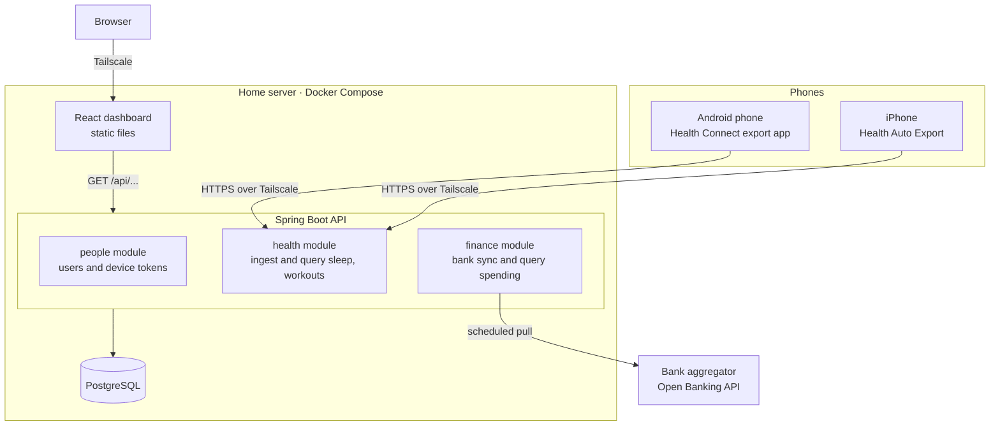

# HomePulse System Design

Status: approved on 2026-10-22.

## Goal

A home dashboard for two people. It shows sleep and workouts from an Android phone and watch and from an iPhone. It also shows spending from a joint Revolut account.

The backend is written by Andrei in Java with Spring Boot as a learning project. Claude guides and writes the frontend.

## Constraints

- Apple Health has no cloud API. Data must be pushed from the iPhone.
- Google Fit APIs are shut down. Health Connect is on the phone only. Data must be pushed from the Android phone.
- Revolut has no public API for personal or joint accounts. We use an Open Banking aggregator.

## Decisions

| Topic | Decision |
|---|---|
| Health input | Third party export apps push JSON to our API |
| Spending input | Open Banking aggregator. Provider to be picked in a spike |
| Hosting | Home server with Docker Compose. Access over Tailscale only |
| Shape | Modular monolith. One Spring Boot app |
| First views | Each person alone. Both side by side. Spending summary |

## 1. Architecture



- Nothing is public. Only devices on the Tailscale network reach the server.
- Phones push health data to `POST /api/ingest/...`.
- The finance module pulls from the bank on a schedule.
- The dashboard reads through `GET /api/...` endpoints.
- Each phone has its own ingest token. The token tells the API whose data it is.
- The dashboard uses a normal login for the two users.

### Stack

- Java 21
- Spring Boot 3 with Gradle
- Spring Data JPA and Flyway
- PostgreSQL
- JUnit 5 and Testcontainers
- React with Vite for the UI

## 2. Data model

```
person          id, name
device          id, person_id, platform, token_hash, last_seen_at
raw_ingest      id, device_id, received_at, payload as jsonb, status, error

sleep_session   id, person_id, start_at, end_at, minutes, source, external_id
workout         id, person_id, type, start_at, end_at, minutes,
                calories, distance_m, avg_heart_rate, source, external_id

bank_connection id, provider, account_ref, consent_expires_at, status
bank_txn        id, connection_id, external_id, booked_at,
                amount, currency, description, merchant, category
```

- **Store raw first.** Every push is saved as is in `raw_ingest` and then parsed. A parser bug can be fixed and the data replayed.
- **Idempotent writes.** A unique key on `person_id + source + external_id` makes repeated pushes harmless.
- **One shape for both phones.** Each platform has a small mapper. Both output the same `SleepSession` and `Workout` records.
- **Time and money.** Times are UTC `Instant`. Money is `BigDecimal` plus currency.
- **Category** comes from the bank at first.

## 3. Data flow and errors

### Health push

1. Phone sends `POST /api/ingest/{platform}` with its token.
2. A security filter hashes the token and finds the device and person. A bad token gets 401.
3. The raw JSON is saved to `raw_ingest` with status `RECEIVED`.
4. The matching mapper parses it into sleep and workout rows. Inserts skip duplicates.
5. The row is marked `PARSED`. On failure it is marked `FAILED` with the error text. The phone still gets 202 since the data is safe.
6. A replay endpoint reparses `FAILED` rows after a bug fix.

### Bank sync

1. A `@Scheduled` job runs a few times a day. Banks cap calls at about four per day per account.
2. It fetches transactions from the last sync date minus three days. The overlap catches late bookings. Duplicates are skipped by `external_id`.
3. Server errors retry with backoff. Client errors do not retry.
4. Bank consent expires every 90 or 180 days. The connection becomes `EXPIRED` and the dashboard shows a reconnect button.

### Dashboard reads

- `GET /api/people/{id}/sleep?from=&to=`
- `GET /api/people/{id}/workouts?from=&to=`
- `GET /api/compare/sleep?from=&to=`
- `GET /api/finance/summary?month=`
- One `@RestControllerAdvice` turns all errors into standard `ProblemDetail` JSON.

### Secrets

- Device tokens are stored hashed.
- Bank keys come from env vars.
- Postgres is reachable only inside Docker.

## 4. Testing and build order

### Testing

- **Mappers.** Plain unit tests fed with real sample payloads saved as files. These matter most.
- **Controllers.** `@WebMvcTest` checks routes, auth and error JSON.
- **Database.** `@DataJpaTest` with Testcontainers runs a real Postgres. It proves the duplicate skip works.
- **Bank client.** WireMock fakes the aggregator. No real bank calls in tests.

### Milestones

| # | Milestone | You learn |
|---|---|---|
| 0 | Spikes. Pick Android export app and bank aggregator. Save sample payloads | Reading API docs |
| 1 | Skeleton. Spring Boot app, Postgres in Docker, Flyway, health check | Boot, Gradle, config, profiles |
| 2 | People and device tokens | JPA entities, repositories, Spring Security filters |
| 3 | iPhone ingest | Controllers, Jackson, transactions, idempotency |
| 4 | Android ingest | Interfaces, dependency injection, strategy pattern |
| 5 | Read APIs and dashboard v1. Claude builds the UI | Query design, DTOs, validation |
| 6 | Bank sync | RestClient, OAuth, `@Scheduled`, retries |
| 7 | Spending summary and dashboard v2 | Aggregation queries |
| 8 | Deploy to home server with Tailscale | Docker images, env config |

Health comes before the bank on purpose. The bank signup may take time so milestone 0 starts it early.

## Out of scope for now

- Mixed health and money views.
- Custom spending categories.
- Native phone apps.

## Open items

Both are handled in milestone 0.


- Pick the Android export app. Check it can push to a custom URL.
- Pick the bank aggregator. Check it accepts personal developer signups and supports Revolut in our country.
